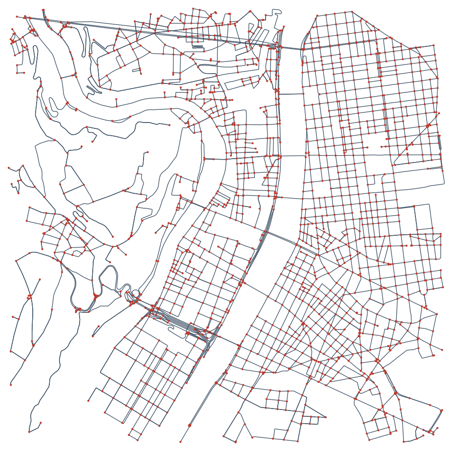

<!-- _class: lead -->
<!-- _paginate: false -->

# Optimisation de tournées logistiques

Plus court chemin, TSP et CVRP sur le réseau routier de Lyon

Louisan Tchitoula · Sofia <span class="todo">NOM</span> · Faustine <span class="todo">NOM</span>

<span class="todo">Nom du cours</span>

<!-- Partie 1 : presentation/01_probleme.md -->

---

# Le problème et sa modélisation

- Un entrepôt, **N clients** avec une demande, des camionnettes de **capacité Q**
- Quel chemin entre deux adresses ? Dans quel ordre livrer ? Quel client dans quel camion ?

<div class="pipeline">
  <div>OpenStreetMap</div><span>→</span>
  <div>Graphe<br><small>G = (V, E)</small></div><span>→</span>
  <div>Plus court chemin<br><small>Dijkstra, A*</small></div><span>→</span>
  <div>Matrice<br><small>dépôt + N clients</small></div><span>→</span>
  <div>TSP<br><small>1 véhicule</small></div><span>→</span>
  <div>CVRP<br><small>plusieurs véhicules</small></div>
</div>

- Nœuds = intersections, arêtes = rues, poids = longueur en mètres
- TSP et CVRP sont NP-difficiles : heuristiques + écart à l'optimum

---

# D'OpenStreetMap au CSV

<div class="cols">
<div>

- OSMnx (Python) télécharge les routes dans un **carré** de demi-côté R autour de Bellecour
- Plus grande composante connexe
- Identifiants renumérotés de 0 à n−1
- `nodes.csv`, `edges.csv`, `meta.txt`, en pleine précision

</div>
<div><div class="note">Lyon, R = 2000 m : 1 886 nœuds, 3 021 rues</div></div>
</div>

<!-- Partie 2 : presentation/02_donnees_osm.md -->

---

# Le graphe en C

- Liste d'adjacence : environ 3 rues par nœud
- Pour nos 5 344 nœuds : matrice V × V de `double` = 228 Mo, liste d'adjacence < 1 Mo
- Graphe non orienté : chaque rue dans les deux sens

| Demi-côté R | Nœuds | Rues |
|---|---|---|
| 500 m | 154 | 224 |
| 1000 m | 550 | 850 |
| 2000 m | 1 886 | 3 021 |
| 4000 m | 5 344 | 8 128 |

---

# Dijkstra

- Extraire le nœud non traité le plus proche, le figer, relâcher ses arêtes
- **Invariant** : un nœud extrait a sa distance définitive, car les poids sont ≥ 0
- Chemin reconstruit avec `prev[]`, de la cible vers la source

```c
for (Edge *e = g->adjacency[u]; e != NULL; e = e->next) {
  double candidate = dist[u] + e->weight;
  if (candidate < dist[e->to]) {
    dist[e->to] = candidate;
    prev[e->to] = u;
  }
}
```

<div class="note">Extrait simplifié de src/dijkstra.c</div>

<!-- Partie 3 : presentation/03_dijkstra.md -->

---

# Deux versions, et comment on sait que c'est juste

<div class="cols">
<div>

| | Minimum | Complexité |
|---|---|---|
| V1 | tableau | `O(V²)` |
| V2 | tas binaire | `O((V+E) log V)` |

- Lazy deletion : on réinsère, et on ignore les entrées périmées
- Tests : graphe jouet du CLRS, inatteignable, source invalide
- Oracle exhaustif : 100 graphes aléatoires (≤ 8 nœuds), 0 écart

</div>
<div class="ph">Courbe B1 : temps V1 / V2 / A* selon V</div>
</div>

---

# A\* : Dijkstra avec une boussole

<div class="cols">
<div>

- `f(n) = g(n) + h(n)`
- `g` : distance parcourue
- `h` : vol d'oiseau (Haversine) jusqu'à la cible
- Hart, Nilsson et Raphael (1968) : optimal si `h` ne surestime jamais

</div>
<div class="ph">Nœuds explorés : Dijkstra (disque) vs A* (ellipse vers la cible)</div>
</div>

<!-- Partie 4 : presentation/04_astar.md -->

---

# Pourquoi c'est encore optimal

- **Admissible** : une route est au moins aussi longue que la ligne droite
- **Consistante** : `h(u) ≤ w(u,v) + h(v)`, donc pas de réouverture
- Arrêt quand la cible **sort** du tas
- Même distance que Dijkstra sur toutes nos requêtes (à 1e-9 près)

<div class="key">À requête égale (arrêt à la cible pour les deux), A* explore <span class="todo">À MESURER</span> % des nœuds de Dijkstra</div>

---

# De la matrice à la tournée

<div class="cols">
<div>

- Matrice **(N+1) × (N+1)** : un Dijkstra par point, arrêté quand tous les points sont extraits
- Tournée fermée depuis le dépôt
- **Plus proche voisin**, `O(N²)`
- **2-opt** : remplacer `(a,b)`, `(c,d)` par `(a,c)`, `(b,d)` si c'est plus court, jusqu'au minimum local

</div>
<div class="ph">Schéma 2-opt : tournée croisée → décroisée</div>
</div>

<!-- Partie 5 : presentation/05_tsp.md -->

---

# Est-ce que c'est bon ?

- Optimum exact par **Held-Karp** (`O(N² · 2^N)`) jusqu'à 15 points
- Instance publique **berlin52** (TSPLIB)

| | Longueur | Écart à l'optimum | Temps |
|---|---|---|---|
| Plus proche voisin | <span class="todo">À MESURER</span> | <span class="todo">À MESURER</span> | <span class="todo">À MESURER</span> |
| NN + 2-opt | <span class="todo">À MESURER</span> | <span class="todo">À MESURER</span> | <span class="todo">À MESURER</span> |

---

# CVRP : Clarke & Wright (1964)

<div class="cols">
<div>

- Départ : un aller-retour par client
- Économie : `s(i,j) = d(0,i) + d(0,j) − d(i,j)`
- Fusionner par économie décroissante si la charge ≤ Q
- `O(N² log N)`

</div>
<div class="ph">Schéma : deux allers-retours fusionnés en une tournée</div>
</div>

<!-- Partie 6 : presentation/06_cvrp.md -->

---

# Or-opt, vérifications et résultats

- Or-opt : déplacer 1 à 3 clients vers une meilleure position
- Contrôles : client servi une fois, capacité respectée, tournées dépôt → dépôt
- A-n32-k5 (CVRPLIB) : optimum 784 avec 5 véhicules, distances arrondies

| | Distance | Véhicules | Écart | Temps |
|---|---|---|---|---|
| Clarke & Wright | <span class="todo">À MESURER</span> | <span class="todo">À MESURER</span> | <span class="todo">À MESURER</span> | <span class="todo">À MESURER</span> |
| C&W + Or-opt | <span class="todo">À MESURER</span> | <span class="todo">À MESURER</span> | <span class="todo">À MESURER</span> | <span class="todo">À MESURER</span> |

---

<!-- _class: lead -->

# Démo

`path` · `tsp` · `cvrp` sur Lyon, dans Docker

<!-- Partie 7 : presentation/07_demo.md. Plan B : vidéo. -->

---

# Bilan : le compromis qualité / temps

<div class="cols">
<div>

- Chaîne complète : carte réelle → tournées multi-véhicules
- La structure de données change l'ordre de grandeur
- Une bonne heuristique garde l'optimalité (A\*)
- Une amélioration locale gagne <span class="todo">À MESURER</span> % pour <span class="todo">À MESURER</span>

</div>
<div class="ph">Écart à l'optimum en fonction du temps : NN, NN + 2-opt, C&W, C&W + Or-opt</div>
</div>

<!-- Partie 8 : presentation/08_conclusion.md -->

---

# Limites et suites

- Sens uniques ignorés ; distance et non temps de trajet
- Demandes synthétiques, pas de fenêtres horaires
- Minimum local pour 2-opt et Or-opt
- Suites : Contraction Hierarchies (Geisberger et al., 2008), vitesses OSM, recuit simulé

---

<!-- _class: lead -->
<!-- _paginate: false -->

# Merci

Questions ?

github.com/LTOssian/logistics-route-optimizer

---

# Annexe : complexités

| Algorithme | Temps | Mémoire |
|---|---|---|
| Dijkstra V1 | `O(V²)` | `O(V)` |
| Dijkstra tas | `O((V+E) log V)` | `O(V+E)` |
| A\* | pire cas de Dijkstra | `O(V+E)` |
| Matrice | `O(N (V+E) log V)` | `O(N²)` |
| Plus proche voisin | `O(N²)` | `O(N)` |
| 2-opt, Or-opt | `O(N²)` par passe | `O(N)` |
| Held-Karp | `O(N² 2^N)` | `O(N 2^N)` |
| Clarke & Wright | `O(N² log N)` | `O(N²)` |

---

# Annexe : protocole de mesure

- Même machine, image Docker du projet, compilation `-O2`
- `CLOCK_MONOTONIC`, 5 répétitions, médiane
- Graine 42 (générateur maison) pour les points, les paires et les demandes
- Données OSM figées : date d'extraction et version d'OSMnx dans `meta.txt`
- Environnement détaillé dans `benchmarks/ENV.md`

<!-- Détail : presentation/annexe_benchmarks.md -->
